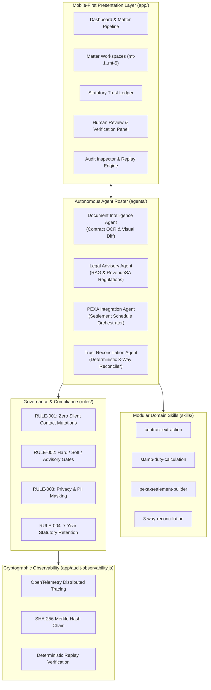

# ConvenientConveyance 🏛️⚖️
### Agentic AI Practice Management System (CPMS) for Australian Conveyancing

[](https://github.com/virendrakulkarni-design/ConvenientConveyance/actions/workflows/deploy.yml)
[](https://virendrakulkarni-design.github.io/ConvenientConveyance/)
[](https://www.arnecc.gov.au/)
[](https://www.lawsocietysa.asn.au/)
[](#observability--audit-trail)
[](#observability--audit-trail)

---

## 🚀 Live Application
* **Production Demo**: **[https://virendrakulkarni-design.github.io/ConvenientConveyance/](https://virendrakulkarni-design.github.io/ConvenientConveyance/)**
* **Mobile Ready**: Fully responsive across mobile phones (375px+), tablets, and desktop workstations.

---

## 📖 Overview
**ConvenientConveyance** is an enterprise-grade Conveyancing Practice Management System (CPMS) engineered for Australian property law jurisdictions (specialized for South Australia).

Unlike legacy conveyancing platforms (such as triConvey or Smokeball) that rely on static desktop applications and mail-merge templates, ConvenientConveyance introduces an **autonomous multi-agent AI architecture** governed by strict **Human-in-the-Loop (HITL) compliance gates**, **real-time 3-way statutory trust reconciliation**, and **cryptographically verifiable audit trails**.

Inspired by agent-harness best practices (such as [`affaan-m/ECC`](https://github.com/affaan-m/ECC)), all agent personas, skills, and governance rules are formalized as declarative contracts.

---

## 🏗️ System Architecture



---

## ✨ Key Capabilities

### 1. Autonomous Multi-Agent AI Stack
* **Document Intelligence Agent (`agents/document-intelligence-agent.md`)**: Ingests contracts of sale and Form 1 disclosure PDFs, extracts 14 statutory fields with confidence scoring, and presents a field-by-field **Visual Diff modal** with inline practitioner editing.
* **Legal Advisory Agent (`agents/legal-advisory-agent.md`)**: Uses Retrieval-Augmented Generation (RAG) against SA legislation to identify statutory relief (e.g., SA June 2024 First Home Buyer Stamp Duty relief up to $700,000) and triages items into checklist, dismissed, or permanent discard lists.
* **PEXA Integration Agent (`agents/pexa-integration-agent.md`)**: Calculates net settlement destination lines, balancing council rates, SA Water adjustments, and mortgagee discharges.
* **Trust Reconciliation Agent (`agents/trust-reconciliation-agent.md`)**: Runs continuous 3-way double-entry reconciliation between bank statements, internal cash books, and client sub-ledgers.

### 2. Human-in-the-Loop (HITL) Gate Tiers
* 🔴 **HARD GATES**: Mandatory practitioner approval required for any financial movement or PEXA workspace locking.
* 🟡 **SOFT GATES**: Side-by-side Visual Diff verification for contract data extraction.
* 🔵 **ADVISORY GATES**: Legal recommendations with immutable timestamped approval/discard audit trails.
* 🛡️ **Zero Silent Modifications**: Absolute prohibition on background or unconfirmed relationship/contact updates.

### 3. Observability, Explainability & Replay Engine
* **Every Activity Logged**: Practitioner authorizations, AI inferences, PEXA syncs, and trust journals are captured in structured OpenTelemetry format (`traceId`, `spanId`, `durationMs`, `model`, `tokens`).
* **Explainability**: Plain-English decision rationale and governing statutory legal citations for every event.
* **Deterministic Replay**: Auditors can simulate and replay any historical event to verify zero state divergence.
* **Cryptographic Proof**: Immutable SHA-256 Merkle chain with one-click **Verify Chain** compliance reporting and JSON/CSV dossier export.

### 4. 100% Mobile & Touch-First Responsive
* Clean off-canvas sliding navigation drawer with dark backdrop.
* Full-width (100vw) Human Review panel on mobile screens.
* Momentum touch scrolling for settlement tables and milestone pipelines.

---

## 📂 Repository Structure

```
ConvenientConveyance/
├── .github/
│   └── workflows/
│       └── deploy.yml              # Automated GitHub Pages CI/CD deployment
├── agents/                         # Declarative Agent Roster (ECC Standard)
│   ├── document-intelligence-agent.md
│   ├── legal-advisory-agent.md
│   ├── pexa-integration-agent.md
│   └── trust-reconciliation-agent.md
├── rules/                          # Governance Guardrails & Enforcement
│   ├── zero-silent-modifications.md
│   ├── hitl-governance.md
│   ├── security-and-privacy.md
│   └── statutory-compliance.md
├── skills/                         # Modular Domain Execution Skills
│   ├── contract-extraction/SKILL.md
│   ├── stamp-duty-calculation/SKILL.md
│   ├── pexa-settlement-builder/SKILL.md
│   └── 3-way-reconciliation/SKILL.md
├── app/                            # Decoupled Production Web Application
│   ├── index.html                  # Single Page Application entrypoint
│   ├── app.js                      # Central router & state manager
│   ├── data.js                     # Seed store & mock repository
│   ├── audit-observability.js      # OpenTelemetry & SHA-256 Merkle Engine
│   ├── ai-copilot.js               # Human Review drawer controller
│   ├── view-dashboard.js           # Practice KPIs & pipeline view
│   ├── view-workspaces.js          # Conveyancing matter directory
│   ├── view-matter-detail.js       # Matter workspace tabs & audit trail
│   ├── view-clients.js             # Client directory & VOI tracking
│   ├── view-properties.js          # Property parcels & map hovercards
│   ├── view-documents.js           # Document assembly & legal templates
│   ├── view-trust.js               # Statutory Trust Accounting ledger
│   ├── view-settings.js            # Admin panel & practice-wide audit log
│   ├── layout.css                  # Responsive flex/grid shell & drawers
│   ├── components.css              # Cards, tables, diff inputs & badges
│   ├── theme.css                   # Theme engine (Royal Sapphire, etc.)
│   └── start.bat                   # 1-click local launch script
└── docs/                           # Architecture Specifications & FAQs
    ├── FAQS.md                     # Technical & Competitive FAQs
    ├── OBSERVABILITY_AND_AUDIT.md  # Detailed Observability & Audit Guide
    ├── CPMS Agentic AI Stack Design.docx
    ├── Domain Model & Data.docx
    └── Platform Foundation.docx
```

---

## 💻 Quick Start (Local Development)

### Option 1: Double-Click (Windows)
Double-click `app/start.bat` to launch the local web server and open your browser automatically.

### Option 2: Command Line
```bash
# Clone the repository
git clone https://github.com/virendrakulkarni-design/ConvenientConveyance.git
cd ConvenientConveyance

# Start a local HTTP server
npx serve app -p 8080
# Or using Python:
# python -m http.server 8080 -d app
```
Navigate to `http://localhost:8080` in any modern desktop or mobile browser.

---

## ⚖️ License & Compliance
This software architecture is developed for Australian legal and conveyancing practitioners in compliance with the **Electronic Conveyancing National Law (ECNL)**, the **ARNECC Model Participation Rules**, and the **Law Society of South Australia** statutory regulations.
