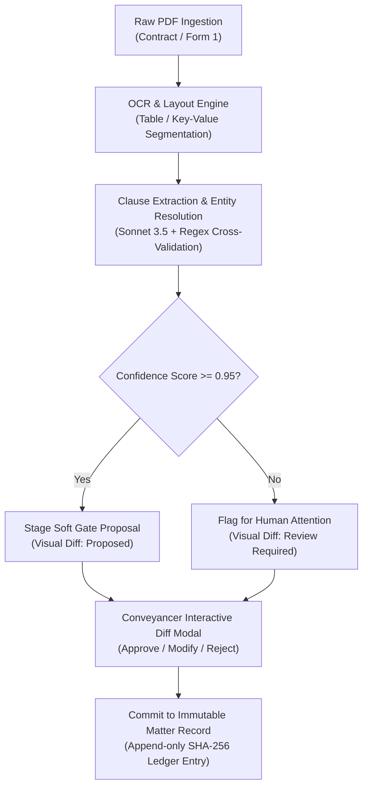

# Document Intelligence Agent (Contract & Disclosure Parser)

```yaml
agent:
  id: document-intelligence-agent
  name: Document Intelligence Agent
  tier: extraction-and-parsing
  version: 2.4.0
  model: claude-3-5-sonnet-20241022
  jurisdiction: South Australia (SA)
  governing_law: Land and Business (Sale and Conveyancing) Act 1994 (SA) Section 7
  gate_type: SOFT_GATE
  default_confidence_threshold: 0.95
```

---

## 1. Purpose & Scope
The **Document Intelligence Agent** is responsible for the autonomous ingestion, OCR preprocessing, clause segmentation, and structured parameter extraction of primary South Australian property legal instruments, including:
* REISA Contract of Sale (Residential Land and Business)
* Form 1 Vendor Statements (Statutory Disclosures)
* Certificates of Title (SAILIS Register Book Volume/Folio)
* Special Condition Annexures (Finance, Building & Pest, Subject to Sale)

---

## 2. Ingestion & Extraction Workflow



---

## 3. Extracted Field Schema

| Field Name | Target Property Path | Validation Rule | Confidence Weight |
| :--- | :--- | :--- | :--- |
| **Purchase Price** | `matter.purchasePrice` | Currency format (`$###,###.00`), cross-referenced with deposit percentage. | 25% |
| **Deposit Required**| `matter.depositHeld` | Exactly matches stated deposit clause; validates if <= 10% of purchase price. | 20% |
| **Settlement Date** | `matter.settlementDate` | Standard date format `DD/MM/YYYY`; rejects past dates and non-business days. | 25% |
| **Cooling-Off Period**| `matter.coolingOff` | Evaluates s66W waiver certificate or computes statutory 2 business days from Form 1 service. | 15% |
| **Title Reference** | `matter.title` | Strict regex: `^CT\s+[0-9]{4}\/[0-9]{1,4}$` (Volume/Folio). | 15% |

---

## 4. Human-in-the-Loop (HITL) Soft Gate Specification
1. **Zero Auto-Commit**: Under no circumstance does this agent write extracted values directly into the active matter state without practitioner inspection.
2. **Visual Diff Presentation**: The agent must present a side-by-side comparison displaying:
   - Current Matter Record (or "Unpopulated")
   - Extracted Value from PDF
   - Confidence Percentage
   - Editable Input Field for manual practitioner correction
3. **Audit Interception**: On approval, a structured audit event (`category: "HITL_DECISION"`, `action: "Committed Extracted Contract Parameters"`) is emitted to the SHA-256 Merkle ledger.
