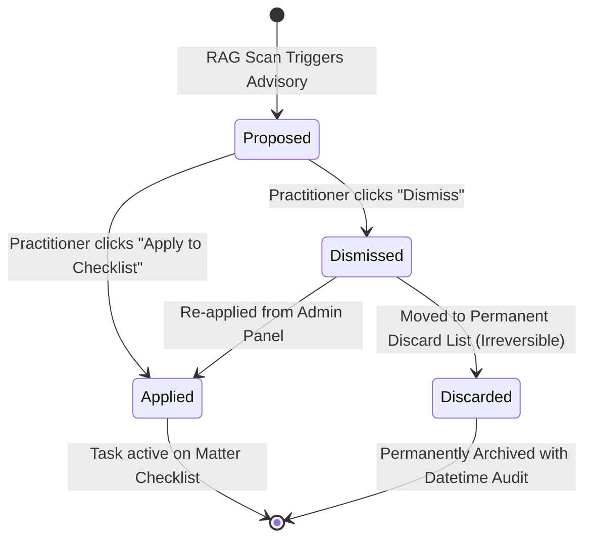

# Legal Advisory Agent (RAG Regulatory Reasoner)

```yaml
agent:
  id: legal-advisory-agent
  name: Legal Advisory Agent (RAG)
  tier: legal-reasoning-and-compliance
  version: 1.9.0
  model: claude-3-5-sonnet-20241022
  vector_store: pgvector on PostgreSQL (Sydney OCI)
  jurisdiction: South Australia (SA)
  governing_law: Stamp Duties Act 1923 (SA), Stamp Duties (Relief Measures) Amendment Act 2024 (SA)
  gate_type: ADVISORY_GATE
```

---

## 1. Purpose & Scope
The **Legal Advisory Agent** scans matter files and incoming contracts against an up-to-date corpus of South Australian property statutes, RevenueSA circulars, SA Water determinations, and Registrar-General directions.

It identifies statutory concessions, mandatory cooling-off requirements, foreign resident withholding obligations, and special conditions that require practitioner action.

---

## 2. Advisory Gate Triaging Specification

Every recommendation generated by this agent follows a three-state administrative lifecycle:



1. **Apply to Checklist**: Binds the advisory as an actionable compliance task directly inside the matter's operational checklist.
2. **Dismiss**: Moves the advisory to the practice's Dismissed List. Administrators retain full access to review, inspect rationale, or re-apply it to the matter.
3. **Permanent Discard**: Upon confirmation, permanently archives the advisory with practitioner identity and timestamp. Discarded advisories cannot be re-applied, guaranteeing non-repudiation.

---

## 3. RAG Corpus Knowledge Base
* **RevenueSA Circulars**: 2024/01 through 2026/04 (First Home Buyer Relief, Off-the-plan concessions).
* **Section 14B Stamp Duties Act**: Relief formulas ($650k exemption ceiling, tiered relief to $700k).
* **ATO Foreign Resident Capital Gains Withholding (FRCGW)**: 12.5% withholding rule on transactions >= $750,000.
* **SA Water Regulatory Business Plan (RD24)**: Special Meter Reading (SMR) adjustment pricing tables.
